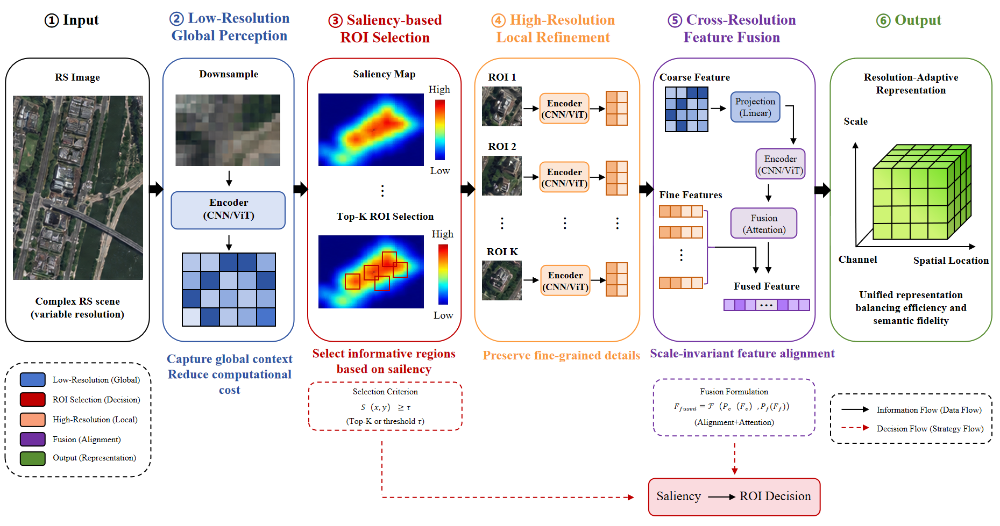
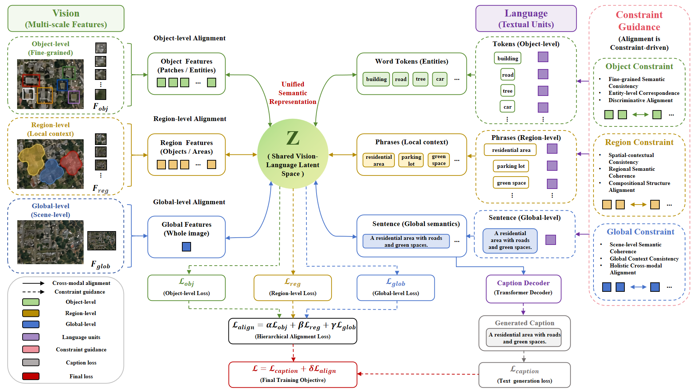
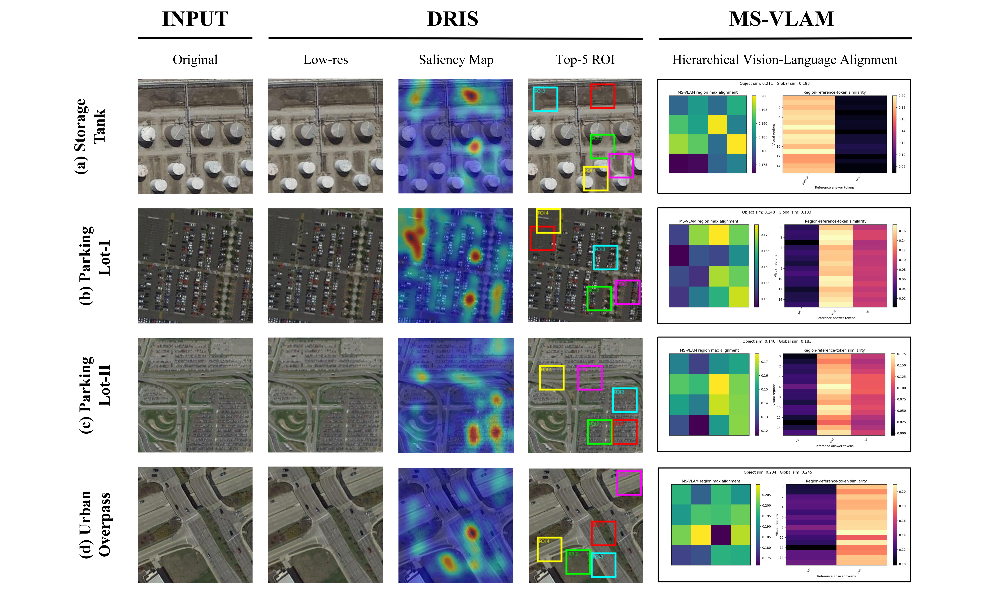
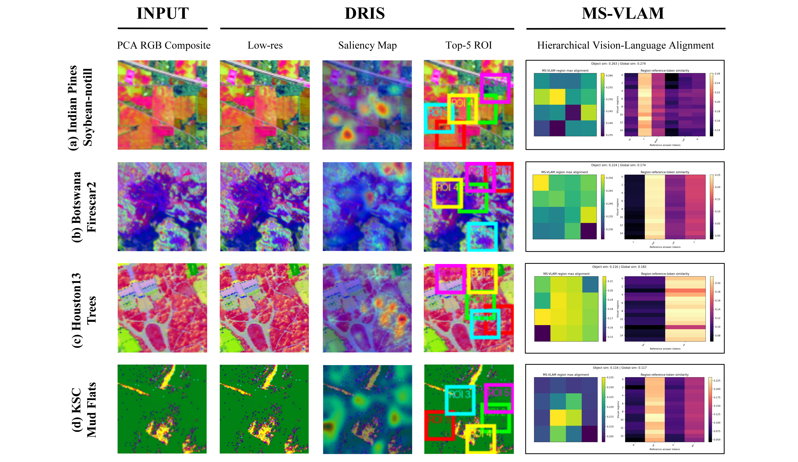

# RAH-VLA: Resolution-Adaptive Hierarchical Vision-Language Alignment for Multimodal Remote Sensing Understanding

<p align="center">
  
</p>

<p align="center">
  <a href="https://github.com/ZhangSiyu0066">Siyu Zhang</a><sup>1</sup>,
  Lianlei Shan<sup>2</sup>,
  Runhe Qiu<sup>1</sup>,
  Wenxin Zhong<sup>1</sup>
</p>

<p align="center">
  <b><sup>1</sup>Sanda University, <sup>2</sup>Tsinghua University</b>
</p>

<p align="center">
  <a href="https://github.com/ZhangSiyu0066/RAH-VLA">
    
  </a>
  <a href="https://arxiv.org/abs/2512.23243">
    
  </a>
  <a href="https://github.com/ZhangSiyu0066/RAH-VLA">
    
  </a>
  <a href="LICENSE">
    
  </a>
</p>


## 🔭 Overview

### Motivation

Remote sensing images contain extreme scale diversity: large scenes, dense regional structures, and small objects often appear in the same image. A fixed-resolution encoder treats all regions equally, while global-only alignment cannot explicitly model object- and region-level semantics. RAH-VLA is designed to preserve fine visual details where they matter and align them with language at multiple semantic granularities.

<p align="center">
  
</p>

<p align="center"><i>Fig. 1. Motivation of RAH-VLA. The framework handles extreme scale variation and semantic mismatch through adaptive visual perception and hierarchical vision-language alignment.</i></p>

### RAH-VLA

RAH-VLA is a multimodal remote sensing vision-language framework built upon GeoChat. It addresses two practical limitations of existing remote sensing VLMs: fixed-resolution visual encoding, which can miss small objects or waste computation on homogeneous regions, and single-scale image-text alignment, which weakens object- and region-level semantic correspondence.

The method introduces two coupled modules. **DRIS** performs coarse-to-fine token-level visual encoding and keeps high-resolution information for salient regions. **MS-VLAM** projects visual features into the language space and aligns them at object, region, and global levels. Together, they improve captioning, grounding, reasoning, hyperspectral generalization, and inference efficiency.

### Framework

The overall framework contains two core components:

| Component | Role | Main idea |
|---|---|---|
| **DRIS** | Visual encoding | Builds a low-resolution global branch and a high-resolution local branch, then fuses visual tokens according to saliency-guided token selection. |
| **MS-VLAM** | Cross-modal alignment | Constructs local/object-level, region-level, and global-level visual-language representations and fuses them for downstream generation. |

The implementation used in this repository follows the paper setting: Vicuna-7B-v1.5 as the language model, CLIP ViT-L/14 as the vision encoder, LoRA-based incremental training, and bf16 mixed precision.

<p align="center">
  
</p>

<p align="center"><i>Fig. 2. RAH-VLA framework. DRIS performs resolution-adaptive visual encoding, and MS-VLAM performs hierarchical alignment across object, region, and global levels.</i></p>

## 🧠 Method

### DRIS: Dynamic Resolution Input Strategy

DRIS is the resolution-adaptive visual encoder of RAH-VLA. Remote sensing images usually contain both large homogeneous areas and tiny semantic objects. Processing every patch at high resolution is expensive, while processing the whole image at low resolution loses boundaries, textures, and small objects. DRIS resolves this trade-off with a coarse-to-fine allocation rule.

<p align="center">
  
</p>

<p align="center"><i>Fig. 3. DRIS pipeline. Low-resolution global perception estimates saliency, top-K ROIs are refined at high resolution, and cross-resolution fusion produces a compact but detail-preserving representation.</i></p>

The dynamic resolution assignment is formulated as:

```text
R(x, y) = R_high, if s(x, y) >= tau
        = R_low,  otherwise

tau = mu_s + lambda * sigma_s
```

Here, `s(x, y)` is the regional saliency score estimated from the low-resolution branch, `R_high` and `R_low` denote high- and low-resolution processing modes, and `tau` is an adaptive threshold computed from the mean `mu_s` and standard deviation `sigma_s` of the saliency map. The sensitivity coefficient `lambda` controls how strict the high-resolution selection is. In the paper setting, `lambda = 1.0` unless otherwise stated.

After candidate salient regions are identified, a fixed-budget top-k strategy selects the final ROIs:

```text
P_ROI = Topk(GaussianBlur(A_coarse), k)
```

`A_coarse` is the coarse attention heatmap from the low-resolution branch. Gaussian smoothing suppresses noisy responses and keeps spatially stable salient regions, while `Topk` selects the highest-response regions. The paper uses `k = 5` to keep computation consistent across samples.

For cross-resolution fusion, DRIS first combines coarse global context and fine local detail:

```text
F_fused = Upsample(F_coarse) + Crop(F_fine, Omega)
```

Because coarse and fine features come from different resolutions and receptive fields, they are projected into a shared latent space and normalized before final fusion:

```text
F_tilde_coarse = LN(W_c F_coarse)
F_tilde_fine   = LN(W_f F_fine)
F_fused        = Upsample(F_tilde_coarse) + Crop(F_tilde_fine, Omega)
```

This projection-based alignment lets the model preserve global scene context from the low-resolution branch while injecting high-resolution details from selected ROIs. Therefore, DRIS is not only an efficiency module; it also produces object-aware and region-aware visual representations for the downstream MS-VLAM alignment.

### MS-VLAM: Multi-scale Vision-Language Alignment

MS-VLAM organizes the DRIS-enhanced visual tokens into three semantic levels and aligns each level with the corresponding textual units. This is designed for remote sensing scenes where semantics are distributed across small objects, local regions, and global scene context.

<p align="center">
  
</p>

<p align="center"><i>Fig. 4. MS-VLAM mechanism. Object-, region-, and global-level visual features are aligned with corresponding textual units under hierarchical constraint guidance.</i></p>

**Object-level alignment.** Fine-grained object regions are aligned with entity-level text tokens. Given the visual feature map `V` and the `p`-th candidate object region `B_p`, the object visual and textual features are:

```text
v_obj^(p) = f_v(RoI(V, B_p))
o_obj^(p) = f_t(e_p)
cos(u, v) = u^T v / (||u|| ||v||)
```

The object-level loss uses localization-aware weighting, so accurately localized objects contribute more strongly:

```text
L_obj = 1 - (1 / P) * sum_p w_p * cos(v_obj^(p), o_obj^(p))

w_p = IoU(B_hat_p, B_p) / sum_q IoU(B_hat_q, B_q)
```

**Region-level alignment.** Region-level features model local spatial context and object interactions. Visual regions are matched with phrase-level embeddings, such as `residential area`, `parking lot`, or `green space`. MS-VLAM combines hard region-phrase matching with contrastive soft matching:

```text
p_j = PhraseEmbed(t_j)
L_reg^hard = 1 - (1 / K) * sum_k cos(v_k, p_{pi(k)})

s_kj = v_k^T p_j / tau_c
L_reg^NCE = -(1 / K) * sum_k log exp(s_{k,y(k)}) / sum_j exp(s_kj)

L_reg = mu * L_reg^hard + (1 - mu) * L_reg^NCE
```

This lets the model handle one-to-many and many-to-one correspondences between visual regions and language phrases.

**Global-level alignment.** The global representation captures holistic scene semantics. Spatial Pyramid Pooling aggregates the visual feature map at multiple scales, and the resulting vector is aligned with the sentence-level textual representation:

```text
g = SPP(V)
L_glob = 1 - cos(g, t_[CLS])
```

The final hierarchical alignment objective combines the three semantic levels:

```text
L_align = alpha * L_obj + beta * L_reg + gamma * L_glob
alpha + beta + gamma = 1
```

In the paper, `alpha`, `beta`, and `gamma` are optimized jointly and normalized with a softmax operation, allowing adaptive balancing across object-, region-, and global-level supervision.

Finally, hierarchical alignment is trained together with caption generation:

```text
L_caption = - sum_t log P_L(x_t | V, x_<t)
L = L_caption + delta * L_align
```

This objective encourages generated captions and responses to be fluent, visually grounded, and semantically consistent across multiple spatial granularities.

## 📁 Project Structure

```
RAH-VLA/
├── geochat/
│   ├── model/
│   │   ├── multimodal_encoder/
│   │   │   ├── dris_encoder.py          # DRIS encoder
│   │   │   ├── dris_builder.py         # DRIS builder
│   │   │   ├── clip_encoder.py         # CLIP encoder
│   │   │   └── builder.py              # encoder builder
│   │   ├── multimodal_projector/
│   │   │   ├── ms_vlam_projector.py    # MS-VLAM projector
│   │   │   └── builder.py              # projector builder
│   │   ├── alignment_loss.py           # multi-scale alignment loss
│   │   └── geochat_arch.py             # model architecture
│   ├── eval/                            # evaluation scripts
│   ├── train/                           # training scripts
│   └── serve/                           # inference service
├── config/
│   └── dris_msvlam_config.py          # DRIS-MSVLAM configuration
├── demo_dris_msvlam.py                # demo script
├── README_DRIS_MSVLAM.md              # DRIS-MSVLAM detailed documentation
├── docs/
│   └── DRIS_MSVLAM.md                 # detailed technical documentation
├── scripts/                           # training scripts
└── images/                            # image assets
```

---

## 🚀 Quick Start

### 1. Install Dependencies

```bash
# Clone the repository
git clone git@github.com:ZhangSiyu0066/RAH-VLA.git
cd RAH-VLA

# Create a conda environment
conda create -n rsvlm python=3.10 -y
conda activate rsvlm

# Install the package
pip install --upgrade pip  # enable PEP 660 support
pip install -e .

# Install training dependencies
pip install ninja
pip install flash-attn --no-build-isolation
```

### 2. Run the DRIS-MSVLAM Demo

```bash
# Run all demos
python demo_dris_msvlam.py

# Run a specific demo
python demo_dris_msvlam.py --demo dris    # DRIS only
python demo_dris_msvlam.py --demo msvlam  # MS-VLAM only
python demo_dris_msvlam.py --demo loss    # loss function only

# Use a custom image
python demo_dris_msvlam.py --image path/to/image.png --demo all
```

### 3. Configure the Model

```python
from config.dris_msvlam_config import get_config

# Get the full model configuration
config = get_config('full_model')

# Get ablation configurations
config = get_config('dris_only')      # DRIS only
config = get_config('msvlam_only')    # MS-VLAM only
config = get_config('dris_msvlam_no_obj')  # MS-VLAM without object-level alignment
```

---

## 🔧 Training

### Train with DRIS-MSVLAM

```bash
python geochat/train/train.py \
    --model_name_or_path lmsys/vicuna-7b-v1.5 \
    --vision_tower openai/clip-vit-large-patch14 \
    --use_dris True \
    --use_msvlam True \
    --dris_low_res_size 224 \
    --dris_high_res_size 504 \
    --dris_top_k_rois 5 \
    --msvlam_alpha 1.0 \
    --msvlam_beta 1.0 \
    --msvlam_gamma 1.0 \
    --delta 1.0 \
    --data_path data/your_data.json \
    --output_dir output/dris_msvlam_model \
    --bf16 True
```

### Training Arguments

#### DRIS Arguments

| Argument | Default | Description |
|------|--------|------|
| `use_dris` | `False` | Enable DRIS. |
| `dris_low_res_size` | `224` | Low-resolution input size. |
| `dris_high_res_size` | `504` | High-resolution input size. |
| `dris_roi_threshold` | `0.5` | ROI selection threshold. |
| `dris_top_k_rois` | `5` | Number of selected ROIs. |
| `dris_saliency_kernel_size` | `5` | Gaussian kernel size. |

#### MS-VLAM Arguments

| Argument | Default | Description |
|------|--------|------|
| `use_msvlam` | `False` | Enable MS-VLAM. |
| `msvlam_alignment_dim` | `768` | Alignment-space dimension. |
| `msvlam_num_regions` | `16` | Number of region-level features. |
| `msvlam_alpha` | `1.0` | Object-level loss weight (alpha). |
| `msvlam_beta` | `1.0` | Region-level loss weight (beta). |
| `msvlam_gamma` | `1.0` | Global-level loss weight (gamma). |
| `msvlam_mu` | `0.5` | Balance between hard matching and contrastive learning. |
| `msvlam_temperature` | `0.07` | Temperature parameter. |

#### Loss Arguments

| Argument | Default | Description |
|------|--------|------|
| `delta` | `1.0` | Alignment loss weight (delta). |
| `label_smoothing` | `0.0` | Label smoothing factor. |
| `ignore_index` | `-100` | Ignored label index. |

---

## 📚 Documentation

### DRIS-MSVLAM Documentation

For detailed technical documentation and implementation notes, see:
- **[README_DRIS_MSVLAM.md](README_DRIS_MSVLAM.md)** - DRIS-MSVLAM implementation summary
- **[docs/DRIS_MSVLAM.md](docs/DRIS_MSVLAM.md)** - detailed technical documentation

These documents include:
- Detailed algorithm descriptions
- Mathematical formulas and equations
- Usage examples and code
- Configuration instructions
- Training guidelines
- Evaluation protocols
- Ablation studies
- Troubleshooting
- FAQ

### Additional Documents

- **[docs/MODEL_ZOO.md](docs/MODEL_ZOO.md)** - model weights and download instructions
- **[docs/Evaluation.md](docs/Evaluation.md)** - evaluation guide
- **[docs/LoRA.md](docs/LoRA.md)** - LoRA training guide
- **[docs/Data.md](docs/Data.md)** - dataset guide
- **[docs/Customize_Component.md](docs/Customize_Component.md)** - component customization guide

---

## 🧪 Ablation Studies

### 可用配置

```python
from config.dris_msvlam_config import ABLATION_CONFIGS

# 基线 (无 DRIS, 无 MS-VLAM)
config_baseline = get_config('baseline')

# 仅 DRIS
config_dris_only = get_config('dris_only')

# 仅 MS-VLAM
config_msvlam_only = get_config('msvlam_only')

# 完整模型 (DRIS + MS-VLAM)
config_full = get_config('full_model')

# MS-VLAM 消融
config_no_obj = get_config('dris_msvlam_no_obj')
config_no_region = get_config('dris_msvlam_no_region')
config_no_global = get_config('dris_msvlam_no_global')
```

---

## 💡 Practical Tips

### 内存优化
- 使用梯度累积增加有效批次大小
- 减少批次大小
- 降低 `dris_high_res_size`
- 减少 ROI 数量

### 训练加速
- 启用混合精度 (`--bf16 True`)
- 使用低分辨率作为起点
- 减少区域数量

### 性能调优
- 调整损失权重 (α, β, γ, δ)
- 增加 warmup 步数
- 使用学习率调度
- 确保数据质量

---

## 🔬 Core Algorithms

### DRIS (动态分辨率输入)

**原理**: 实现粗到细的两阶段处理策略

```python
# Eq. (1) - 动态分辨率分配
R(x,y) = {
    R_high if s(x,y) ≥ τ
    R_low otherwise
}

# Eq. (2) - FPN 特征融合
F_fused = Upsample(F_coarse) + Crop(F_fine, Ω)

# Eq. (3) - ROI 选择
P_ROI = Topk(GaussianBlur(A_coarse), k)
```

**优势**:
- 减少计算开销 2-3 倍
- 保留关键细节信息
- 自适应资源分配

### MS-VLAM (多尺度视觉-语言对齐)

**原理**: 实现三层级对齐机制

```python
# Eq. (7) - 对象级损失
L_obj = 1 - (1/P) Σ w_p · cos(v_obj^(p), o_obj^(p))

# Eq. (11) - 区域级损失
L_reg = μ · L_reg^hard + (1-μ) · L_reg^NCE

# Eq. (12) - 全局级损失
L_glob = 1 - cos(SPP(V), t_[CLS])

# Eq. (13) - 总对齐损失
L_align = α · L_obj + β · L_reg + γ · L_glob
```

**优势**:
- 捕获多粒度语义
- 增强跨模态一致性
- 提升细粒度理解能力

---

## 🏗️ Architecture Notes

RAH-VLA 基于 GeoChat (CVPR 2024) 架构，增强了以下能力：

### 原始 GeoChat 能力
- 图像和区域描述
- 视觉问答 (VQA)
- 场景分类
- 视觉定位对话
- 指代对象检测

### 增强 (DRIS-MSVLAM)
- 动态分辨率处理，提升效率
- 多尺度对齐机制，提升性能
- 更好的细粒度理解
- 改进的跨模态一致性

---

## 📊 Main Results

### Result Highlights

| Task | Dataset / Benchmark | Main result |
|---|---|---|
| Remote sensing captioning | NWPU-Captions, RSICD, UCM, Sydney | Best or highly competitive results across BLEU, METEOR, ROUGE-L, CIDEr, and SPICE. |
| Visual grounding | DIOR-RSVG | **40.27 Accuracy@0.5**, outperforming the strongest baseline MoE-LoRA by **+2.41** points. |
| GPT-4V-based evaluation | RS-GPT4V-Instruct | **6.574 overall score**, higher than Full-FT, LoRA, MoE-LoRA, and general VLM baselines. |
| Hyperspectral generalization | HyperCAP | Overall gains over GeoChat-7B: **+24.9% BLEU-1**, **+43.9% METEOR**, **+33.2% ROUGE-L**, **+149.8% CIDEr**. |
| Efficiency | FLOPs / latency / memory | Reduces FLOPs by **38.4%**, latency by **35.6%**, and memory by **25.3%** compared with the baseline. |

### Image Captioning

RAH-VLA is evaluated on four optical remote sensing captioning benchmarks. The model uses CLIP ViT-L/14 and Vicuna-7B-v1.5 in all rows below.

| Dataset | BLEU-1 | BLEU-2 | BLEU-3 | BLEU-4 | METEOR | ROUGE-L | CIDEr | SPICE |
|---|---:|---:|---:|---:|---:|---:|---:|---:|
| NWPU-Captions | **0.889** | **0.812** | **0.748** | **0.689** | **0.458** | **0.791** | **2.061** | **0.334** |
| RSICD | 0.772 | 0.662 | 0.578 | 0.505 | **0.392** | **0.672** | **2.781** | **0.501** |
| UCM | **0.918** | **0.868** | **0.829** | **0.798** | **0.489** | **0.832** | **3.701** | **0.547** |
| Sydney | **0.927** | **0.872** | **0.826** | **0.793** | **0.482** | **0.789** | **2.864** | **0.458** |

### Visual Grounding and Multimodal Reasoning

| Method | DIOR-RSVG Accuracy@0.5 | GPT-4V Complex Reasoning | GPT-4V Detailed Description | GPT-4V Overall |
|---|---:|---:|---:|---:|
| Qwen-VL-Chat | 25.05 | 2.648 | 2.282 | 2.599 |
| LLaVA-1.5 | 9.52 | 5.210 | 5.088 | 5.194 |
| Full-FT | 36.31 | 6.270 | 6.530 | 6.304 |
| LoRA | 33.15 | 6.061 | 6.374 | 6.103 |
| MoE-LoRA | 37.86 | 6.108 | 6.468 | 6.156 |
| **RAH-VLA (Ours)** | **40.27** | **6.512** | **6.781** | **6.574** |

The grounding result shows stronger fine-grained visual-text correspondence on DIOR-RSVG, while the GPT-4V-based evaluation indicates better response quality for remote sensing reasoning and detailed description.

### HyperCAP Generalization

To test cross-modality transfer, RAH-VLA is evaluated on hyperspectral image captioning using the HyperCAP benchmark.

| Dataset | Method | BLEU-1 | METEOR | ROUGE-L | CIDEr |
|---|---|---:|---:|---:|---:|
| Botswana | GeoChat-7B | 0.0245 | 0.0563 | 0.0332 | 0.0128 |
| Botswana | **RAH-VLA** | **0.0304** | **0.0815** | **0.0433** | **0.0370** |
| Houston13 | GeoChat-7B | 0.0239 | 0.0572 | 0.0324 | 0.0146 |
| Houston13 | **RAH-VLA** | **0.0339** | **0.1028** | **0.0515** | **0.0383** |
| Indian Pines | GeoChat-7B | 0.0263 | 0.0581 | 0.0341 | 0.0155 |
| Indian Pines | **RAH-VLA** | **0.0319** | **0.0758** | **0.0433** | **0.0329** |
| KSC | GeoChat-7B | 0.0087 | 0.0206 | 0.0123 | 0.0082 |
| KSC | **RAH-VLA** | **0.0109** | **0.0349** | **0.0169** | **0.0239** |
| Overall | GeoChat-7B | 0.0214 | 0.0485 | 0.0284 | 0.0124 |
| Overall | **RAH-VLA** | **0.0267** | **0.0698** | **0.0378** | **0.0310** |

### Ablation and Efficiency

| Setting | Accuracy@0.5 |
|---|---:|
| LoRA baseline | 33.15 |
| + DRIS only | 35.62 |
| + MS-VLAM only | 37.04 |
| **DRIS + MS-VLAM** | **40.27** |
| w/o Object-level alignment | 38.91 |
| w/o Local-region-level alignment | 39.10 |
| w/o Global-level alignment | 38.76 |

| Method | FLOPs (G) | Time (ms) | Memory (GB) |
|---|---:|---:|---:|
| Baseline | 286.4 | 164.2 | 21.7 |
| Token Pruning | 238.7 | 139.5 | 19.4 |
| **RAH-VLA** | **176.3** | **105.8** | **16.2** |

These results show that DRIS and MS-VLAM are complementary: adaptive visual perception improves feature quality, while hierarchical alignment improves semantic consistency. RAH-VLA also lowers computation and memory cost compared with fixed-resolution processing.

## 🖼️ Visualization

<p align="center">
  
</p>

<p align="center"><i>Visualization on optical remote sensing images. DRIS selects informative regions, while MS-VLAM strengthens correspondence between text tokens and visual regions.</i></p>

<p align="center">
  
</p>

<p align="center"><i>Visualization on hyperspectral remote sensing images. The method maintains effective region selection and semantic alignment across sensing modalities.</i></p>

## 📜 Citation

如果您在研究中使用了 RAH-VLA 或 DRIS-MSVLAM，请引用以下论文：

### GeoChat (基线)
```bibtex
@article{kuckreja2023geochat,
        title={GeoChat: Grounded Large Vision-Language Model for Remote Sensing},
        author={Kuckreja, Kartik and Danish, Muhammad S. and Naseer, Muzammal and Das, Abhijit and Khan, Salman and Khan, Fahad S.},
        journal={The IEEE/CVF Conference on Computer Vision and Pattern Recognition},
        year={2024}
}
```

### RAH-VLA (本实现)
```bibtex
@article{zhang2025multimodal,
  title={RAH-VLA: Resolution-Adaptive Hierarchical Vision-Language Alignment for Multimodal Remote Sensing Understanding},
  author={Zhang, Siyu and Shan, Lianlei and Qiu, Runhe and Zhong, Wenxin},
  journal={arXiv preprint arXiv:2512.23243},
  year={2025}
}
```

---

## 🙏 Acknowledgements

本项目基于以下开源项目：
- **[GeoChat](https://github.com/mbzuai-oryx/GeoChat)** - CVPR 2024
- **[LLaVA](https://github.com/haotian-liu/LLaVA)** - Large Language-and-Vision Assistant
- **[Vicuna](https://lmsys.org/blog/2023-03-30-vicuna/)** - Large Language Model

感谢这些项目的作者发布的开源代码和模型。

---

## 📄 License

本项目遵循 Apache 2.0 许可证。详见 [LICENSE](LICENSE) 文件。

---

## 🤝 Contributing

欢迎贡献！请遵循以下步骤：

1. Fork 本仓库
2. 创建特性分支 (`git checkout -b feature/AmazingFeature`)
3. 提交更改 (`git commit -m 'Add some AmazingFeature'`)
4. 推送到分支 (`git push origin feature/AmazingFeature`)
5. 开启 Pull Request

---

## 📧 Contact

如有问题或建议，请在 GitHub 上创建 issue。

---

## 🔗 Related Links

- [GeoChat 原始仓库](https://github.com/mbzuai-oryx/GeoChat)
- [GeoChat 项目页面](https://mbzuai-oryx.github.io/GeoChat)
- [GeoChat 论文 (arXiv)](https://arxiv.org/abs/2311.15826)
- [RAH-VLA arXiv](https://arxiv.org/abs/2512.23243)

---

**注意**: 本实现用于研究和教育目的。如需用于商业用途，请联系原作者获取许可。
